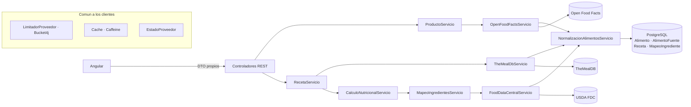

# NutriSport AI — Integración con APIs externas de alimentos y recetas

| Campo | Valor |
|---|---|
| Versión | 1.0 |
| Fecha | 22/11/2026 |
| Alcance | **Ampliación** (ver `PROJECT_PROPOSAL.md` §1.7 y §11) |
| Documentos relacionados | [`PROJECT_PROPOSAL.md`](PROJECT_PROPOSAL.md) §4.8, §4.9, §5.12, §6, §7 · [`DESIGN.md`](DESIGN.md) §7.19–7.23 |

> **Verificación.** Todo lo que aparece en este documento se ha comprobado el 22/11/2026 en la documentación oficial de cada proveedor y con peticiones reales de solo lectura. Lo que la documentación no aclara se marca como **"no documentado"** o **"a verificar"**. Las APIs cambian: revisa los enlaces oficiales antes de implementar.

---

## Índice

1. [Por qué integrar fuentes externas](#1-por-qué-integrar-fuentes-externas)
2. [Responsabilidad de cada proveedor](#2-responsabilidad-de-cada-proveedor)
3. [Open Food Facts](#3-open-food-facts)
4. [TheMealDB](#4-themealdb)
5. [USDA FoodData Central](#5-usda-fooddata-central)
6. [Arquitectura de la integración](#6-arquitectura-de-la-integración)
7. [Cálculo nutricional de recetas externas](#7-cálculo-nutricional-de-recetas-externas)
8. [Variables de entorno](#8-variables-de-entorno)
9. [Licencias y atribución](#9-licencias-y-atribución)
10. [Desarrollo frente a producción](#10-desarrollo-frente-a-producción)
11. [Limitaciones conocidas](#11-limitaciones-conocidas)

---

## 1. Por qué integrar fuentes externas

El catálogo semilla del MVP (200–300 alimentos genéricos revisados) no cubre los **productos envasados** que come un deportista (yogures, barritas, bebidas) ni ofrece **recetas** suficientes para un planificador. Las fuentes externas aportan datos reales sin depender de la IA:

- **Open Food Facts:** productos comerciales por código de barras o por nombre.
- **TheMealDB:** recetas con ingredientes, medidas, instrucciones e imágenes.
- **USDA FoodData Central:** valores nutricionales de ingredientes genéricos. Es necesaria porque **TheMealDB no proporciona nutrientes**.

**Regla común:** ninguna cifra nutricional procede de un modelo generativo. Los nutrientes salen del catálogo, de Open Food Facts o de USDA, y se calculan en el backend.

## 2. Responsabilidad de cada proveedor

| Proveedor | Responsabilidad en NutriSport AI | Lo que **no** aporta |
|---|---|---|
| **Open Food Facts** | Productos comerciales: código de barras, nombre, marca, ingredientes, alérgenos y trazas, nutrientes por 100 g/ml (y por ración si existe), categorías, etiquetas e imagen | Alimentos genéricos fiables ("arroz cocido"); garantía de exactitud (datos colaborativos) |
| **TheMealDB** | Recetas: nombre, categoría, cocina (área), ingredientes, **medidas en texto libre**, instrucciones, imagen y vídeo | Calorías, macronutrientes, número de raciones, alérgenos; textos en español |
| **USDA FoodData Central** | Nutrientes de ingredientes genéricos y **pesos de medidas caseras** (`foodPortions`) para calcular las recetas | Productos españoles; textos en español |
| **Catálogo propio** (PostgreSQL) | Alimentos genéricos en español con alérgenos revisados, caché persistente de todo lo anterior y datos del usuario | — |

No se duplican responsabilidades: Open Food Facts no se usa para recetas, TheMealDB no se usa para nutrientes y USDA no se usa para productos de marca.

## 3. Open Food Facts

**Documentación oficial:** https://openfoodfacts.github.io/openfoodfacts-server/api/ · Términos: https://world.openfoodfacts.org/terms-of-use · Datos y licencias: https://world.openfoodfacts.org/data

### 3.1. Endpoints que se usan

| Uso | Petición | Notas |
|---|---|---|
| Producto por código de barras | `GET https://world.openfoodfacts.org/api/v2/product/{codigo}.json?fields=...` | Documentado en v2. La documentación indica que **v3 es la versión recomendada** para nuevas integraciones (ejemplo de staging: `/api/v3.6/product/{codigo}.json`). Se empieza con v2 por tener ejemplos de producción documentados y se deja la versión en una variable de configuración |
| Búsqueda por texto | `GET https://search.openfoodfacts.org/search?q={texto}&page_size={n}&fields=...` (**Search-a-licious**) | La documentación oficial indica: *"Full-text search is not available in the v2 or v3 server-side API"* y remite a Search-a-licious. Funciona (comprobado), pero su documentación pública es solo una interfaz Swagger: **estabilidad y límites a verificar** |
| Búsqueda por filtros (no texto) | `GET https://world.openfoodfacts.org/api/v2/search?categories_tags_en=...&fields=...&page=&page_size=` | Solo filtros por etiquetas; `search_terms` **no** es un parámetro documentado de v2. Uso opcional |
| *Legacy* | `/cgi/search.pl` | Soporta texto, pero la documentación lo **desaconseja** para nuevas integraciones. No se usa |

**Campos que se piden** (parámetro `fields`, comprobados en una respuesta real):

`code, product_name, brands, quantity, serving_size, serving_quantity, nutrition_data_per, nutriments, ingredients_text, allergens_tags, traces_tags, categories_tags, labels_tags, image_front_url, image_front_small_url, nutrition_grades`

### 3.2. Ejemplo real de petición y respuesta

```http
GET /api/v2/product/3017624010701.json?fields=code,product_name,brands,nutrition_data_per,nutriments,allergens_tags,traces_tags,image_front_small_url HTTP/1.1
Host: world.openfoodfacts.org
User-Agent: NutriSport/0.1 (correo-de-contacto)
```

Respuesta (recortada; valores reales del producto de ejemplo de la documentación):

```json
{
  "code": "3017624010701",
  "status": 1,
  "status_verbose": "product found",
  "product": {
    "product_name": "Nutella",
    "brands": "Ferrero",
    "nutrition_data_per": "100g",
    "nutriments": {
      "energy-kcal_100g": 539, "proteins_100g": 6.3, "carbohydrates_100g": 57.5,
      "sugars_100g": 56.3, "fat_100g": 30.9, "saturated-fat_100g": 10.6, "salt_100g": 0.1075
    },
    "allergens_tags": ["en:nuts"],
    "traces_tags": ["en:milk", "en:nuts", "en:soybeans"],
    "image_front_small_url": "https://images.openfoodfacts.org/..."
  }
}
```

Producto inexistente: la API responde **HTTP 200** con `{"status": 0, "status_verbose": "no code or invalid code"}`. Hay que mirar `status`, no el código HTTP.

Observaciones de la respuesta real:

- En ese producto **no venían** `serving_size`, `serving_quantity`, las claves `*_serving` ni `fiber_100g`. Todos los campos secundarios son **opcionales** en nuestro modelo.
- En Search-a-licious `brands` llega como **array** y en v2 como **texto**: el normalizador acepta ambos.

### 3.3. Autenticación, límites y User-Agent

| Aspecto | Valor oficial |
|---|---|
| Autenticación | Lectura **sin autenticación** (*"do not require authentication other than the custom User-Agent"*). Escritura con usuario (no se usa) |
| User-Agent | Obligatorio y personalizado: `NombreApp/Versión (correo de contacto)` |
| Límite de productos | **15 peticiones/min por IP** (`GET /api/v*/product`) |
| Límite de búsquedas | **10 peticiones/min por IP**; la documentación advierte expresamente que **no se use para "buscar mientras escribes"** |
| Al superarlos | Posible **bloqueo de IP**; existen además límites globales que devuelven **HTTP 503** |
| Uso esperado | *"1 API call = 1 real scan by a user"*; para cientos de productos, usar las **exportaciones** (CSV/JSONL diarias) |
| Staging | `https://world.openfoodfacts.net` con autenticación HTTP básica `off`/`off`; la documentación pide usarlo **mientras se prueba** |

> **Consecuencia de diseño:** todas las llamadas salen del backend, es decir, de **una sola IP** para todos los usuarios. 10 búsquedas por minuto es un límite **compartido**. Por eso:
> 1. La búsqueda consulta primero el catálogo local, que incluye los productos ya vistos.
> 2. Open Food Facts solo se consulta cuando el usuario **pulsa** "Buscar en productos comerciales" (nunca al teclear).
> 3. Los productos se guardan en PostgreSQL y las búsquedas, en caché.

### 3.4. Normalización a nuestro modelo

| Open Food Facts | NutriSport (`Alimento` + `AlimentoFuente`) |
|---|---|
| `code` | `codigoBarras`; `AlimentoFuente.referenciaExterna` |
| `product_name`, `brands` | `nombre`, `marca` (si `brands` es array, se une con ", ") |
| `nutriments.energy-kcal_100g`, `proteins_100g`, `carbohydrates_100g`, `fat_100g` | `kcal100`, `proteinas100`, `carbohidratos100`, `grasas100` (**obligatorios** para poder registrar el producto) |
| `sugars_100g`, `saturated-fat_100g`, `fiber_100g`, `salt_100g` | Campos opcionales (`NULL` = "dato no disponible", nunca 0) |
| `nutrition_data_per` | `unidadBase` (`100g` → G; `100ml` → ML) |
| `serving_size`, `serving_quantity` | Porción "ración del envase" si existen |
| `ingredients_text` | `ingredientesTexto` |
| `allergens_tags`, `traces_tags` (`en:gluten`, `en:milk`, `en:nuts`…) | `alergenosContiene`, `alergenosTrazas` (tabla de correspondencia con los 14 alérgenos UE); `alergenosRevisados = false` |
| `categories_tags` | Categoría local por correspondencia o "Otros" |
| `image_front_small_url` | `imagenUrl` (se muestra con atribución; no se copia la imagen) |

Si faltan energía o alguno de los tres macronutrientes, el producto se muestra con el aviso **"Información nutricional incompleta"** y no se puede añadir a una comida. El usuario puede crear un alimento propio a partir de él.

## 4. TheMealDB

**Documentación oficial:** https://www.themealdb.com/api.php · Términos: https://www.themealdb.com/terms_of_use.php

### 4.1. Endpoints (API v1, clave de prueba `1`)

| Uso | Petición | Respuesta |
|---|---|---|
| Buscar por nombre | `GET /api/json/v1/1/search.php?s={nombre}` | Recetas completas |
| Listar por primera letra | `GET /api/json/v1/1/search.php?f={letra}` | Recetas completas |
| Detalle por id | `GET /api/json/v1/1/lookup.php?i={idMeal}` | Receta completa |
| Receta aleatoria | `GET /api/json/v1/1/random.php` | Receta completa |
| Categorías | `GET /api/json/v1/1/categories.php` | `idCategory`, `strCategory`, `strCategoryThumb`, `strCategoryDescription` (14 categorías) |
| Listas | `GET /api/json/v1/1/list.php?c=list` · `?a=list` · `?i=list` | Categorías, áreas, ingredientes (`idIngredient`, `strIngredient`, `strDescription`, `strThumb`, `strType`) |
| Filtrar por ingrediente | `GET /api/json/v1/1/filter.php?i={ingrediente}` | **Solo** `strMeal`, `strMealThumb`, `idMeal` (y `strArea`, `strCountry`) |
| Filtrar por categoría | `GET /api/json/v1/1/filter.php?c={categoria}` | Igual que el anterior (p. ej. 81 recetas en `Chicken`) |
| Filtrar por área | `GET /api/json/v1/1/filter.php?a={area}` | Igual que el anterior |
| Solo *Premium* | `/api/json/v2/{clave}/filter.php?i=a,b,c` (varios ingredientes), `randomselection.php`, `latest.php` | No se usan |

Base: `https://www.themealdb.com`. Sin resultados → `{"meals": null}`.

### 4.2. Ejemplo real

```http
GET /api/json/v1/1/lookup.php?i=52850 HTTP/1.1
Host: www.themealdb.com
```

```json
{
  "meals": [{
    "idMeal": "52850",
    "strMeal": "Chicken Couscous",
    "strCategory": "Chicken",
    "strArea": "Moroccan",
    "strInstructions": "Heat the olive oil in a large frying pan and cook the onion for 1-2 mins just until softened. ...",
    "strMealThumb": "https://www.themealdb.com/images/media/meals/qxytrx1511304021.jpg",
    "strIngredient1": "Olive Oil",      "strMeasure1": "1 tbsp",
    "strIngredient2": "Onion",          "strMeasure2": "1 chopped",
    "strIngredient3": "Chicken Breast", "strMeasure3": "200g",
    "strIngredient4": "Ginger",         "strMeasure4": "pinch",
    "strIngredient5": "Harissa Spice",  "strMeasure5": "2 tblsp ",
    "strIngredient6": "Dried Apricots", "strMeasure6": "10",
    "strIngredient7": "Chickpeas",      "strMeasure7": "220g",
    "strIngredient8": "Couscous",       "strMeasure8": "200g",
    "strIngredient9": "Chicken Stock",  "strMeasure9": "200ml",
    "strIngredient10": "Coriander",     "strMeasure10": "Handful",
    "strIngredient11": "",              "strMeasure11": ""
  }]
}
```

Observaciones:

- Los huecos de ingredientes llegan como `""` o `null` (hasta el 20).
- Las medidas son **texto libre** e inconsistente: `"2 tblsp "` lleva un espacio al final y aparecen valores como `"Handful"` o `"pinch"`.
- No existen campos de traducción (`strInstructionsES` u otros).

### 4.3. Clave, límites y condiciones

| Aspecto | Valor oficial |
|---|---|
| Clave de prueba `1` | *"You can use the test API key "1" during development of your app or for educational use"* |
| Publicación | *"you must become a supporter if releasing publicly on an appstore"*. Los términos: no se puede publicar en una tienda de apps sin ser *paid subscriber*. Es un **pago único** (*lifetime*); **el precio no aparece** en las páginas oficiales consultadas |
| Límites | Los términos mencionan *"rate limit"*, pero **no publican la cifra**. Nos autolimitamos (§6.4) |
| Listados | Sin suscripción, ciertos listados están *"limited to 100 items"* |
| Scraping | Prohibido: solo la API oficial |
| Imágenes de recetas | `strMealThumb` + `/small` (200 px), `/medium` (350 px) o `/large` (500 px). `/small` comprobado |
| Imágenes de ingredientes | `https://www.themealdb.com/images/ingredients/{Nombre}.png` y variantes `-small.png` o `/small` (comprobadas) |
| Datos e imágenes | Se pueden usar citando la fuente: *"You can use our custom artwork in your projects but must mention us as the source of the data"*, sin hacerlo pasar por propio, enlazando a TheMealDB y respetando `strCreativeCommonsConfirmed` |

**Decisión:** el proyecto académico usa la clave `1` (uso educativo). Una publicación real exigiría hacerse *supporter* y usar la clave recibida, que siempre irá en una variable de entorno.

### 4.4. Lo que TheMealDB no aporta y cómo se resuelve

| Falta | Solución |
|---|---|
| Nutrientes | Cálculo propio con USDA y el catálogo (§7) |
| Número de raciones | Valor **supuesto de 4**, marcado como "supuesto" y editable por el usuario; el administrador lo fija al publicar la receta en el catálogo |
| Alérgenos y aptitud dietética | Se **derivan de los ingredientes** emparejados con alimentos del catálogo con alérgenos revisados. La propia guía de TheMealDB advierte de que no se infieran dietas ni alérgenos a partir del nombre, la categoría o las etiquetas. Si algún ingrediente no está emparejado o revisado, la receta queda como **"alérgenos sin verificar"** |
| Español | Categorías y nombres de ingredientes traducidos con tablas propias (los ingredientes emparejados muestran el nombre del catálogo). Instrucciones en inglés con el aviso "Receta original en inglés"; la traducción automática con IA es opcional (Visión) y se etiqueta como tal |
| "Saludable" | TheMealDB no clasifica recetas por salud. Los filtros "alta en proteína" y "menos de X kcal por ración" solo se aplican a recetas con **cálculo nutricional completo o aproximado** |

## 5. USDA FoodData Central

**Documentación oficial:** https://fdc.nal.usda.gov/api-guide/ · Especificación: `https://api.nal.usda.gov/fdc/v1/json-spec`

### 5.1. Endpoints

| Uso | Petición |
|---|---|
| Búsqueda | `GET https://api.nal.usda.gov/fdc/v1/foods/search?api_key={clave}&query={texto}&dataType=Foundation,SR%20Legacy&pageSize=5` |
| Detalle | `GET https://api.nal.usda.gov/fdc/v1/food/{fdcId}?api_key={clave}&format=full` |
| Varios | `GET/POST https://api.nal.usda.gov/fdc/v1/foods` (hasta 20 `fdcIds`) |

Solo se usan los tipos **Foundation** y **SR Legacy** (alimentos genéricos). *Branded* son productos estadounidenses: para productos se usa Open Food Facts.

### 5.2. Ejemplo real

Búsqueda `query=banana raw` → `foods[0]`: `fdcId 173944`, `"Bananas, raw"`, `dataType "SR Legacy"`. Los nutrientes de la **búsqueda** vienen como `nutrientId`, `nutrientNumber`, `unitName` y `value`:

| Nutriente | `nutrientId` | `nutrientNumber` | Valor (Bananas, raw) |
|---|---|---|---|
| Energía | 1008 | 208 | 89 **KCAL** (cuidado: también hay una "Energy" en kJ, id 1062; se filtra por unidad) |
| Proteína | 1003 | 203 | 1,09 g |
| Grasa total | 1004 | 204 | 0,33 g |
| Hidratos (por diferencia) | 1005 | 205 | 22,8 g |

En el **detalle**, la forma cambia: `foodNutrients[].nutrient.{id, number, name, unitName}` y `amount`. El mapeador contempla ambas formas.

`foodPortions` (detalle) da los pesos de las medidas caseras, por ejemplo: `{"amount": 1.0, "modifier": "NLEA serving", "gramWeight": 126.0}`, "cup, sliced" 150 g o "extra small" 81 g. La base de los nutrientes no figura en la respuesta: la FAQ indica que los alimentos Foundation usan medidas de 100 unidades y los valores de SR Legacy son coherentes con 100 g (**a verificar** en la guía al implementar).

### 5.3. Clave, límites y licencia

| Aspecto | Valor oficial |
|---|---|
| Clave | Obligatoria (registro gratuito en https://fdc.nal.usda.gov/api-key-signup). *"It is the API Key holder's responsibility to ensure that their key is not made publicly available"* |
| `DEMO_KEY` | 30 peticiones/hora y 50/día por IP: solo para probar |
| Clave propia | 1.000 peticiones/hora por IP; si se supera, **HTTP 429** y bloqueo de la clave durante 1 hora. Cabeceras `X-RateLimit-Limit` y `X-RateLimit-Remaining` |
| Licencia | Dominio público, **CC0 1.0**. Piden citar la fuente: *"U.S. Department of Agriculture, Agricultural Research Service. FoodData Central"* |
| Idioma | Descripciones en inglés |

## 6. Arquitectura de la integración

### 6.1. Principios

1. **Angular nunca llama a los proveedores.** Solo usa endpoints propios (`/api/v1/...`) con DTO propios; no conoce la estructura de Open Food Facts, TheMealDB ni USDA.
2. **Claves solo en el backend**, en variables de entorno.
3. **El catálogo local es la fuente de verdad en tiempo de ejecución.** Lo externo se normaliza y se guarda con su procedencia; si un proveedor falla, la aplicación sigue funcionando con lo guardado.
4. **Procedencia siempre visible:** cada dato indica si viene del catálogo, de Open Food Facts, de TheMealDB, de USDA o de un cálculo propio. Lo generado por IA lleva siempre la marca de IA.

### 6.2. Servicios (paquete `com.nutrisport.integracion`)



| Servicio | Responsabilidad |
|---|---|
| `OpenFoodFactsServicio` | Cliente HTTP de Open Food Facts (producto por código y búsqueda en Search-a-licious). User-Agent, límites, *timeouts* y traducción de la respuesta a un `ProductoExternoDto` |
| `TheMealDbServicio` | Cliente HTTP de TheMealDB (búsqueda, filtros, detalle, categorías y listas). Convierte las 20 parejas ingrediente/medida en una lista y a `RecetaExternaDto` |
| `FoodDataCentralServicio` | Cliente HTTP de USDA (búsqueda y detalle de Foundation y SR Legacy); extrae los 4 nutrientes por id y las `foodPortions` |
| `NormalizacionAlimentosServicio` | Convierte los DTO externos en `Alimento` + `AlimentoFuente` (unidades, alérgenos a los 14 de la UE, campos opcionales); evita duplicados por `(proveedor, referenciaExterna)` y por código de barras |
| `MapeoIngredientesServicio` | Empareja nombres de ingredientes de TheMealDB con alimentos del catálogo o de USDA; guarda el resultado en `MapeoIngrediente` para reutilizarlo; mantiene una cola de revisión para el administrador |
| `CalculoNutricionalServicio` | Interpreta las medidas, las convierte a gramos, suma los nutrientes, los divide por raciones y calcula la **completitud** (§7) |
| `ProductoServicio` | Orquesta la búsqueda local + Open Food Facts, el código de barras y la caché |
| `RecetaServicio` | Orquesta el catálogo de recetas (propias e importadas), la importación desde TheMealDB, los favoritos, las recetas relacionadas y su uso en menús y listas de la compra |

### 6.3. Errores y *timeouts*

| Situación | Comportamiento |
|---|---|
| *Timeout* (conexión 2 s, lectura 5 s) o 5xx | Un reintento con espera breve; si vuelve a fallar → `EstadoProveedor` "degradado" durante 60 s y respuesta con datos locales |
| HTTP 429 o 503 del proveedor | **No se reintenta**. Se respeta `Retry-After` si existe (si no, 60 s) |
| Open Food Facts `status: 0` | `404 NO_ENCONTRADO` → "No encontramos este producto" |
| TheMealDB `{"meals": null}` | Lista vacía |
| Respuesta con forma inesperada | Se registra en el log (sin datos personales) y se trata como "sin datos" |
| Proveedor no disponible y sin datos locales | `503 PROVEEDOR_NO_DISPONIBLE` con mensaje de alternativa ("Busca otro producto o regístralo manualmente") |

### 6.4. Control de límites (Bucket4j, por proveedor)

| Proveedor | Límite propio | Motivo |
|---|---|---|
| Open Food Facts, producto | 12/min | Por debajo de los 15/min/IP oficiales |
| Open Food Facts, búsqueda | 8/min | Por debajo de los 10/min/IP oficiales |
| TheMealDB | 30/min | Límite no publicado: margen prudente |
| USDA | 900/h | Por debajo de las 1.000/h oficiales |

Si se agota el cupo, se responde con los datos locales y un aviso ("Búsqueda de productos comerciales no disponible en este momento") en lugar de llamar al proveedor.

### 6.5. Caché y almacenamiento

| Dato | Dónde | Duración |
|---|---|---|
| Producto de Open Food Facts | PostgreSQL (`Alimento` + `AlimentoFuente.sincronizadoEn`) | Se reutiliza 30 días; después se refresca al volver a pedirlo |
| Búsqueda en Open Food Facts | Caché en memoria (Caffeine) por texto normalizado | 1 hora |
| Receta de TheMealDB | PostgreSQL (`Receta` con `origen = THEMEALDB`), con ingredientes y cálculo | Permanente; refresco manual del administrador |
| Listas de TheMealDB (filtros, categorías) | Caffeine | 24 horas (categorías: 7 días) |
| Alimento de USDA | PostgreSQL (`Alimento`, fuente `USDA`) | Permanente (CC0) |
| Emparejamiento de ingrediente | PostgreSQL (`MapeoIngrediente`) | Permanente; editable por el administrador |
| Imágenes | No se copian: se usan las URL del proveedor con atribución | — |

### 6.6. Funcionamiento sin proveedores

- **Buscador:** muestra los resultados del catálogo local (incluidos los productos y recetas ya guardados) y un aviso no bloqueante.
- **Escáner:** si el código ya está guardado, funciona igual; si no, ofrece buscar otro producto o crear un alimento propio.
- **Recetas:** el catálogo importado sigue disponible; la exploración de nuevas recetas de TheMealDB queda en pausa.
- **Cálculo nutricional:** usa los emparejamientos ya guardados; los ingredientes nuevos quedan "pendientes" y la receta se marca como incompleta.

## 7. Cálculo nutricional de recetas externas

### 7.1. Proceso

1. **Ingredientes:** se leen las parejas `strIngredientN` / `strMeasureN` no vacías.
2. **Identificación:** se busca el nombre normalizado en `MapeoIngrediente`. Si no existe, se busca en el catálogo (nombre en inglés de los alimentos USDA) y en USDA (Foundation, SR Legacy). Se propone la mejor coincidencia con una confianza y se guarda; si la confianza es baja, queda **pendiente de revisión**.
3. **Cantidad:** se interpreta la medida con un analizador de reglas: números, fracciones (`3/4`, `½`), unidades de masa y volumen (`g`, `kg`, `oz`, `lb`, `ml`, `l`, `cup`, `tbsp`/`tblsp`, `tsp`) y unidades contables (`1 chopped`, `10`, `clove`).
4. **Conversión a gramos:**
   - masa → directa;
   - volumen → `foodPortions` de USDA del alimento emparejado (p. ej. "1 tbsp") o, si no hay, una densidad genérica marcada como estimación;
   - unidades → porción "unidad" del catálogo o `foodPortions` ("medium", "large").
5. **Cantidades despreciables** (`pinch`, `to taste`, `garnish`, `handful` de hierbas): se cuentan como 0 g y se marcan como "despreciable", no como error.
6. **Nutrientes:** `valor100 × gramos / 100` para energía, proteínas, hidratos y grasas.
7. **Suma y división** entre el número de raciones (supuesto 4 si no se ha fijado).
8. **Estado del cálculo:**

| Estado | Condición | Cómo se muestra |
|---|---|---|
| `COMPLETO` | Todos los ingredientes no despreciables emparejados y convertidos con medidas exactas | "Valores estimados a partir de los ingredientes" |
| `APROXIMADO` | ≥ 90 % de la masa resuelta, o alguna conversión por densidad o porción genérica | "Cálculo aproximado · N de M ingredientes" |
| `INCOMPLETO` | < 90 % de la masa resuelta | "Cálculo incompleto": no se muestran totales por ración ni se usa en menús automáticos |

### 7.2. Ejemplo con "Chicken Couscous" (id 52850)

Muestra el mecanismo; los valores por 100 g son **ilustrativos**. La implementación los tomará de USDA o del catálogo.

| Ingrediente (TheMealDB) | Medida | Interpretación | Gramos | Estado |
|---|---|---|---|---|
| Olive Oil | 1 tbsp | 1 × "tbsp" (porción USDA) | ≈ 13,5 | Resuelto |
| Onion | 1 chopped | 1 unidad mediana | ≈ 110 | Resuelto (estimado: porción genérica) |
| Chicken Breast | 200g | Masa | 200 | Resuelto |
| Ginger | pinch | Despreciable | 0 | Despreciable |
| Harissa Spice | 2 tblsp | Sin emparejamiento fiable (supuesto del ejemplo: ninguna coincidencia supera el umbral de confianza) | — | **Sin datos** |
| Dried Apricots | 10 | 10 unidades | Según `foodPortions` | Resuelto (estimado: porción por unidad) |
| Chickpeas | 220g | Masa | 220 | Resuelto |
| Couscous | 200g | Masa (en seco) | 200 | Resuelto |
| Chicken Stock | 200ml | Volumen ≈ masa (densidad 1) | ≈ 200 | Resuelto (estimado) |
| Coriander | Handful | Hierba fresca, despreciable | 0 | Despreciable |

Resultado: **9 de 10 ingredientes resueltos** y tres conversiones estimadas (cebolla, orejones y caldo) → estado **`APROXIMADO`**. Como la harissa es una parte pequeña de la masa total, la completitud queda por encima del 90 % (en el mockup 12, 97 %). Las raciones (4) son **supuestas**. La interfaz lo indica así; nunca presenta el resultado como un valor exacto.

## 8. Variables de entorno

```dotenv
# Open Food Facts (sin clave; User-Agent obligatorio)
OFF_BASE_URL=https://world.openfoodfacts.net        # staging en desarrollo
OFF_SEARCH_URL=https://search.openfoodfacts.org
OFF_USER_AGENT=NutriSport/0.1 (pon-aqui-tu-correo-de-contacto)
OFF_STAGING_USER=off
OFF_STAGING_PASS=off

# TheMealDB
THEMEALDB_BASE_URL=https://www.themealdb.com/api/json/v1
THEMEALDB_API_KEY=1                                  # clave de prueba (uso educativo)

# USDA FoodData Central
USDA_BASE_URL=https://api.nal.usda.gov/fdc/v1
USDA_API_KEY=                                        # clave personal; nunca DEMO_KEY fuera de pruebas
```

Las variables se añaden a `.env.example` sin valores reales; `.env` no se sube al repositorio. Ninguna clave llega a Angular.

## 9. Licencias y atribución

| Fuente | Licencia | Obligaciones | Atribución en la interfaz |
|---|---|---|---|
| Open Food Facts | Base de datos **ODbL**; contenidos **DbCL**; imágenes **CC BY-SA** (pueden contener elementos de terceros, como marcas) | Atribuir con enlace; si se usa públicamente una **base adaptada**, ofrecerla bajo ODbL (*share-alike*) | "Datos de Open Food Facts (ODbL) · openfoodfacts.org" en la ficha del producto, con enlace |
| TheMealDB | Términos propios | Citar la fuente, no hacer pasar el contenido como propio, enlazar; clave de *supporter* para publicar en tiendas | "Receta e imagen: TheMealDB (themealdb.com)" en el catálogo y el detalle |
| USDA FDC | **CC0** | Ninguna obligatoria; piden citar la fuente | "Valores nutricionales: USDA FoodData Central" en el desglose nutricional |

**Implicación de ODbL:** los productos de Open Food Facts se guardan con `AlimentoFuente.proveedor = OPEN_FOOD_FACTS` y quedan separados del resto. Así, si el proyecto se publicara, esa parte de la base se podría compartir bajo ODbL sin mezclarla con datos propios. Para el proyecto académico basta con la atribución visible.

## 10. Desarrollo frente a producción

| | Desarrollo y proyecto académico | Producción (Visión) |
|---|---|---|
| Open Food Facts | Staging `world.openfoodfacts.net` (`off`/`off`) | `world.openfoodfacts.org`; formulario de uso de la API; User-Agent con contacto; valorar las exportaciones JSONL para precargar productos españoles |
| TheMealDB | Clave `1` | Clave de *supporter* (pago único) |
| USDA | Clave personal gratuita (`DEMO_KEY` solo para una prueba rápida) | Clave propia; pedir más cupo si hiciera falta |
| Tests | Respuestas grabadas (WireMock o `MockRestServiceServer`); **los tests nunca llaman a los proveedores reales** | Igual |

## 11. Limitaciones conocidas

- **Open Food Facts:**
  - datos colaborativos *"provided only for indicative information"*, sin garantía de exactitud ni de completitud;
  - campos que faltan con frecuencia (fibra, ración);
  - límite muy bajo para búsquedas compartidas desde un servidor;
  - la búsqueda de texto depende de Search-a-licious, cuya estabilidad no está documentada.
- **TheMealDB:**
  - sin nutrientes, raciones ni alérgenos;
  - solo en inglés;
  - medidas en texto libre;
  - límites no publicados;
  - publicar una app exige pago;
  - el catálogo de recetas no está orientado a la nutrición deportiva (por eso las recetas se filtran por el cálculo propio y el administrador elige cuáles publica).
- **USDA:**
  - descripciones en inglés y alimentos estadounidenses;
  - algunos ingredientes (por ejemplo, mezclas de especias) pueden no tener un equivalente fiable;
  - la conversión por volumen depende de las porciones disponibles.
- **Cálculo de recetas:** siempre es una **estimación**. Depende del emparejamiento de ingredientes y de las conversiones; se informa del estado y de la completitud.
